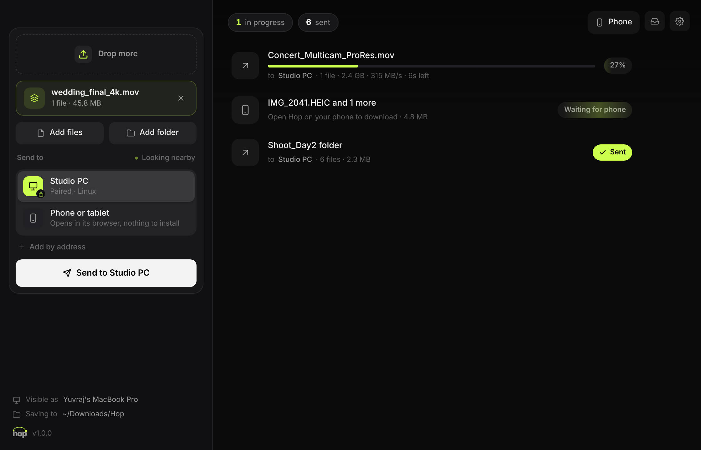
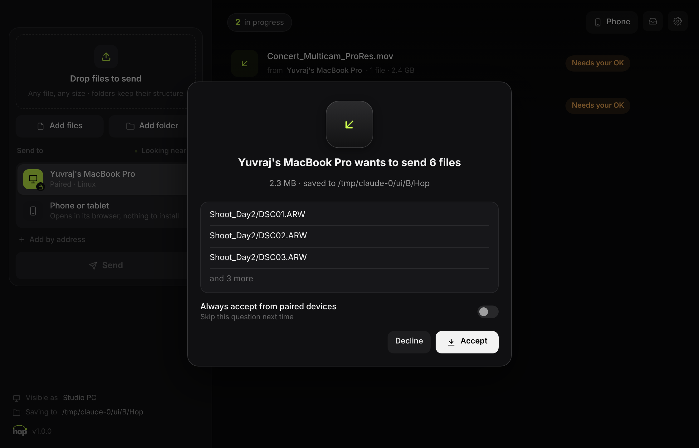
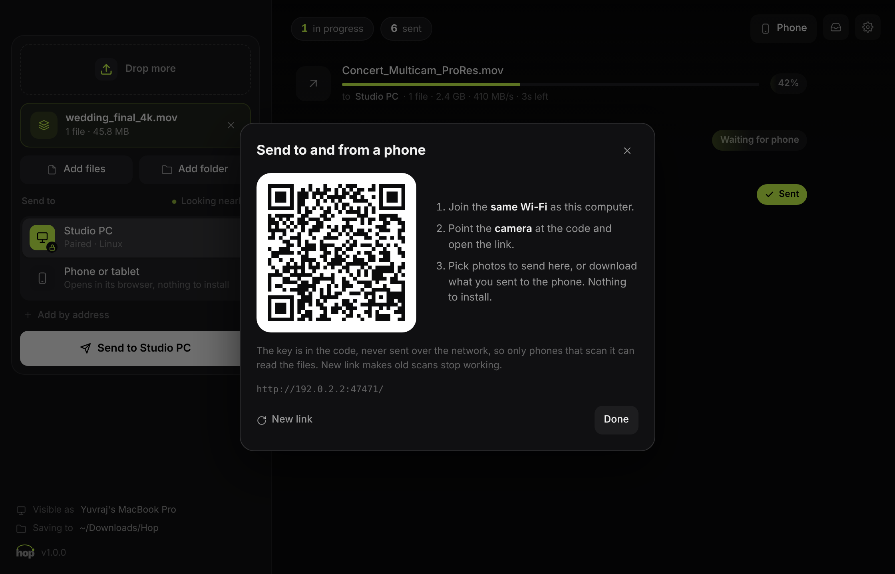
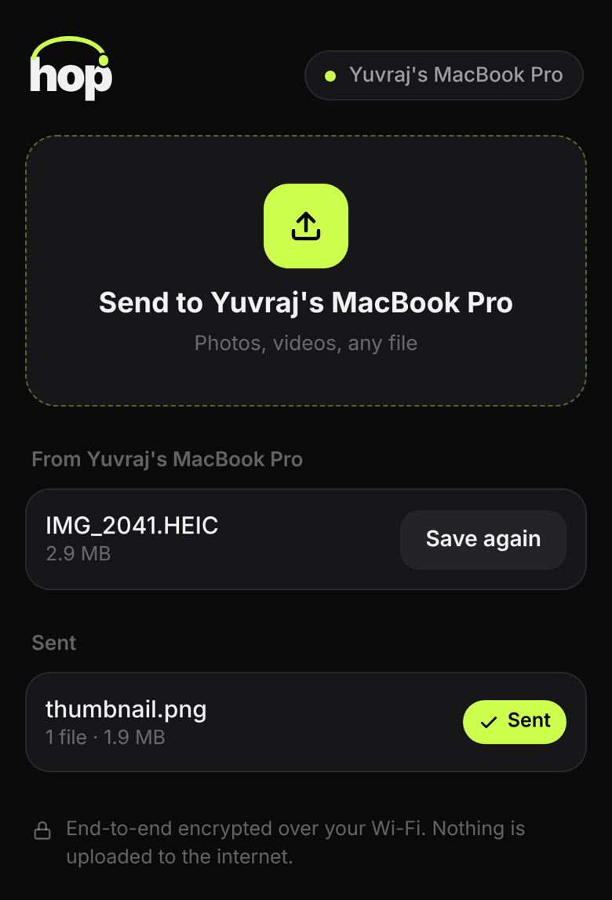

<p align="center">
  
</p>

<h1 align="center">hop</h1>

<p align="center">
  <b>Send files between your Mac, your PC and your phone. No cloud.</b><br>
  Like AirDrop, for every device you own: straight across your Wi-Fi, end-to-end encrypted, any size.<br>
  For macOS and Windows, and any phone's browser.
</p>

<p align="center">
  <a href="https://github.com/YuvrajxGarg/hop/releases/latest"></a>
  
  <a href="LICENSE"></a>
</p>

<p align="center">
  
</p>

## Why

AirDrop stops at the edge of Apple's world, and everything else (cloud drives, chat apps, email) uploads your file to someone's server first, often squeezes it, and makes you wait twice. Hop sends it directly from one device to the other over the Wi-Fi you're already on, at the speed your network allows.

## Download

| Platform | Download | First launch |
|---|---|---|
| **macOS** 11+ · Apple silicon | [**Hop-mac.zip**](https://github.com/YuvrajxGarg/hop/releases/latest/download/Hop-mac.zip) | Unzip and move **Hop** to Applications. The app isn't notarized, so the first time: right-click → **Open**. On macOS 15 and later, go to **System Settings → Privacy & Security → Open Anyway** instead. Allow **Local Network** when asked, so Hop can find your other devices. |
| **Windows** 10 / 11 · 64-bit | [**Hop-windows.zip**](https://github.com/YuvrajxGarg/hop/releases/latest/download/Hop-windows.zip) | Unzip the **Hop** folder somewhere you own (Documents, Desktop) and run **Hop.exe**. If SmartScreen appears, click **More info → Run anyway**. When Windows Firewall asks, allow **Private networks** so other devices can send to you. |
| **Phones** | Nothing to install | Click **Phone** in Hop and scan the QR code. |

Hop checks this repository for new releases and updates itself.

## How it works

1. **Open Hop** on both computers. They find each other on the Wi-Fi automatically.
2. **Drop** files or whole folders and pick a device.
3. **Pair once.** The first time, the other computer shows a 6-digit code. Type it in and you're paired for good.
4. The other side **accepts** (or turns on *Always accept from paired devices*), and the files land in `Downloads/Hop`.

<p align="center">
  
</p>

### Phones

Click **Phone**, scan the code with the phone's camera, and Hop opens in the phone's browser. Send photos and videos to the computer, or drop files onto *Phone or tablet* in Hop and save them on the phone. iPhone, Android, iPad, anything with a browser.

<p align="center">
  
  
</p>

## Under the hood

| | |
|---|---|
| **Discovery** | Each Hop advertises itself with Bonjour / mDNS (`_hop._tcp`). Nothing leaves your network. If your network blocks Bonjour (some offices and hotels), use **Add by address**. |
| **Pairing** | [SPAKE2](https://datatracker.ietf.org/doc/rfc9382/), a password-authenticated key exchange, over the 6-digit code. Someone listening on the Wi-Fi can't test guesses offline, and each code allows one guess, so a 1-in-a-million code is plenty. Both sides then prove they derived the same 256-bit key. |
| **Encryption** | Every 1 MiB chunk is sealed with XSalsa20-Poly1305 (NaCl secretbox, via libsodium). Each chunk is bound to its transfer, file and position, so pieces can't be swapped, replayed or tampered with. |
| **Integrity** | Each file's SHA-256 is checked on arrival before it's moved into place. A mismatch is re-sent automatically. |
| **Resume** | The transfer id comes from the files' hashes, so if the Wi-Fi drops, a laptop sleeps or either app quits, sending the same files again picks up where it stopped. |
| **Speed** | Four chunks in flight at once over keep-alive connections. Usually limited by your Wi-Fi, not Hop. |
| **Phones** | The QR code carries a one-time key in the URL fragment (after `#`), which browsers never send over the network. The page encrypts and decrypts in the browser with [tweetnacl](https://tweetnacl.js.org), the same format as the desktop app. |

## Command line

```bash
hop send ~/Desktop/export.mov                # to the only computer nearby, or pick from a list
hop send ~/Shoots/day2 --to "Studio PC"      # by name, or --to 192.168.1.20
hop receive -o ~/Incoming                    # wait for files; prints pairing codes
hop receive --yes                            # accept from paired devices without asking
hop phone ~/Desktop/cut.mp4                  # QR code in the terminal, offers the file to a phone
hop devices                                  # list Hop devices on this network
hop forget "Studio PC"                       # unpair
```

On macOS the binary lives at `Hop.app/Contents/MacOS/Hop`. From source, run `python Hop.py …`.

## Limits

- **Same network.** Both devices need to be on the same Wi-Fi or LAN. Hop never relays through the internet. Guest networks with "client isolation" block device-to-device traffic.
- **Phone page over plain HTTP.** The files are end-to-end encrypted, but the page itself comes from your computer over unencrypted HTTP, because browsers won't trust a certificate for a local IP address. Someone who controls your Wi-Fi could in theory tamper with that page. Computer-to-computer transfers don't have this limit.
- **Phone downloads use memory.** A phone assembles a received file in memory before saving it, so very large files (several GB) are better sent computer to computer.

## Build from source

You need Python 3.9+. On macOS, [uv](https://docs.astral.sh/uv/) is the easiest way to get it.

```bash
pip install -r requirements.txt
python Hop.py
```

| | |
|---|---|
| **macOS app** | `./build_mac.sh` builds `dist/Hop.app`. Add `--install` to copy it to `~/Applications`. |
| **Windows app** | `build_windows.bat` builds `dist\Hop\Hop.exe`. |
| **Tests** | `python -m unittest discover tests` (two Hop nodes pair, send, resume and refuse strangers on this computer) |
| **UI in a browser** | `HOP_UI_DEV=8801 python Hop.py` serves the window at http://127.0.0.1:8801. Set `HOP_HOME` to a folder to run a second copy with its own identity. |

### Layout

```
hop/node.py        the engine: HTTP server, pairing, chunked transfers, resume, phone endpoints
hop/crypto.py      SPAKE2 pairing and sealed messages
hop/discovery.py   Bonjour / mDNS
hop/cli.py         the command line
hop/webapp.py      the window: HTML/CSS UI in a native WebKit / WebView2 view (pywebview)
hop/updater.py     GitHub Releases updater (check → download → verify → swap)
hop/ui/            the desktop interface
hop/web/           the phone page
Hop.spec           PyInstaller recipe for both platforms
```

## Releasing

1. Bump `VERSION` and commit.
2. Tag and push:

   ```bash
   git tag v1.0.1 && git push origin v1.0.1
   ```

3. The **Release** workflow builds, tests and smoke-tests both apps, then attaches `Hop-mac.zip` and `Hop-windows.zip` (each with a `.sha256`) to the release. Installed copies pick it up on their next update check.

## License

[MIT](LICENSE). The phone page bundles [tweetnacl-js](https://github.com/dchest/tweetnacl-js) (public domain).
